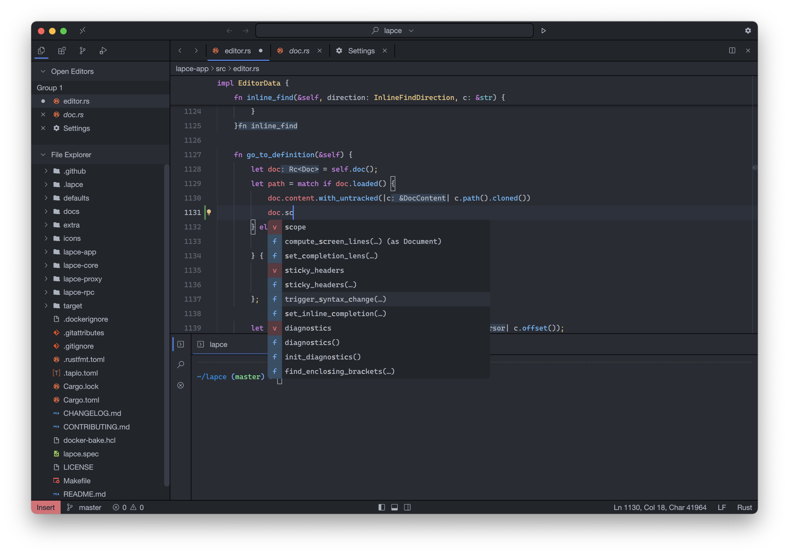

<h1 align="center">
   
  editor.izdrail.com
</h1>

<h4 align="center">A fast Rust code editor with VS Code content import</h4>

  

 

editor.izdrail.com is a native code editor written in Rust with a [Floem](https://github.com/lapce/floem) UI and [wgpu](https://github.com/gfx-rs/wgpu) rendering. It is a derivative of [Lapce](https://github.com/lapce/lapce) (Apache License 2.0, copyright the Lapce contributors), with its own highlighting engine, language server client, WASI plugin host, VS Code extension import and keymap presets. Debugging (DAP) is not part of this editor.

## Features

### Editing
* Modal (Vim-like) editing, toggleable with `Core > Modal`
* Rope-based buffer, built-in terminal, git and search panels, remote workspaces
* Debug mode (`--debug` or `LAPCE_DEBUG=1`): verbose logs, crash reports with backtraces and language server crash details ([docs/debugging.md](docs/debugging.md))
* Local code folding (groundwork, see [docs/local-folding.md](docs/local-folding.md))
* Syntax highlighting with Lexilla ([docs/lexilla-highlighting.md](docs/lexilla-highlighting.md)), including dedicated PHP and Laravel lexers ([docs/php-lexers.md](docs/php-lexers.md)), plus TextMate grammars imported from `.vsix` files for languages Lexilla has no lexer for

### Language server client
Independent stdio LSP client: completion (with resolve), hover, go to definition and diagnostics. A global `language-servers.toml` registry seeds TypeScript/JavaScript, Python, HTML, CSS and JSON (npm-managed) and Rust, Go and PHP (command-managed, must be installed). Custom servers are supported. See [docs/language-servers.md](docs/language-servers.md).

### Executable plugins (WASI)
Lapce-style WASI plugins run in the proxy's plugin catalog: they can provide language features (completion, hover, code actions, formatting, ...), spawn their own language servers and react to editor events. Editor requests fan out to both the built-in language server client and plugins. See [docs/wasi-plugins.md](docs/wasi-plugins.md).

### Snippet packs
Laravel, WordPress, Symfony and Twig snippets, offered by project type. See [docs/snippet-packs.md](docs/snippet-packs.md).

### Project scripts
Run and Debug lists `npm`/`composer`/`artisan` scripts from your project. See [docs/project-scripts.md](docs/project-scripts.md).

### Prettier formatting
Projects with a Prettier config and binary are formatted through it on save. See [docs/format-on-save.md](docs/format-on-save.md).

### Open in Browser
"Open in Browser" in the command palette shows the active HTML/SVG file in your browser. See [docs/open-in-browser.md](docs/open-in-browser.md).

### Auto-close tags
Typing `>` after an opening tag in HTML, Twig, Blade and Vue files inserts the closing tag (`auto-close-tags` setting). See [docs/auto-close-tags.md](docs/auto-close-tags.md).

### Import PHP Class
Palette command that adds a sorted `use` line for the class under the cursor, from composer.json PSR-4 paths and vendor packages. See [docs/import-class.md](docs/import-class.md).

### Go to Route
Laravel and Symfony route list in the command palette ("Go to Route") jumping to controller methods. See [docs/go-to-route.md](docs/go-to-route.md).

### Emmet
Expand HTML (`ul>li.item*3`) and CSS (`m10-20`) abbreviations with `Ctrl+Alt+M`. See [docs/emmet.md](docs/emmet.md).

### Completion popup
LSP results, imported snippets and buffer words in one fuzzy-ranked popup, in that priority order. See [docs/completion-popup.md](docs/completion-popup.md).

### Themes and icons marketplace
Install colour themes and icon themes from the registry in the Themes & Icons panel. Theme/icon packages are validated data packages (HTTPS-only, size-bounded, no executable files); executable WASI plugins install through the same hardened pipeline. See [docs/data-only-marketplace.md](docs/data-only-marketplace.md).

### VS Code extension import
`lapce --install-vsix FILE...` imports the declarative parts of `.vsix` files: colour themes, icon themes, snippets, language configuration and TextMate grammars. Extension code (`main`) is never executed; such extensions are marked "contains code, not loaded". Packages from [Open VSX](https://open-vsx.org) work; check each extension's licence. See [docs/vsix-import.md](docs/vsix-import.md).

### VS Code API shim (experimental)
An opt-in, deliberately small CommonJS command shim runs in a seccomp-restricted worker process (Linux x86_64 only). It is reached from the command palette (`Experimental VS Code: Run sandbox hello`) and never activates installed extensions. See [docs/vscode-sandbox-experiment.md](docs/vscode-sandbox-experiment.md).

### Keymap presets
`Settings > Core > Keymap Preset`: `compact-65` (default, no Fn layer needed), `vscode`, `phpstorm`, `sublime`, `notepad-plus-plus` and `lapce` (original defaults). Your `keymaps.toml` always wins. See [docs/keymap-presets.md](docs/keymap-presets.md).

## Install

Linux x86_64 binaries are attached to [GitHub releases](https://github.com/izdrail/editor.izdrail.com/releases) when a version tag (`vX.Y.Z`) is pushed. To build from source, see [docs/building-from-source.md](docs/building-from-source.md).

## CI

* **Linux build** runs on every branch push on GitHub-hosted `ubuntu-22.04` and publishes the binary as a workflow artifact.
* **Linux release** runs only for `vX.Y.Z` tags and attaches the Linux binary to the release.
* **CI** (build and doc tests) runs on pull requests and manual dispatch.

## Contributing

See [CONTRIBUTING.md](CONTRIBUTING.md). Release steps are in [docs/new-release.md](docs/new-release.md).

## License

This project is a derivative of Lapce, copyright the Lapce contributors, and is released under the Apache License 2.0, the same license as upstream. Upstream copyright and attribution notices are retained. See [LICENSE](LICENSE).
